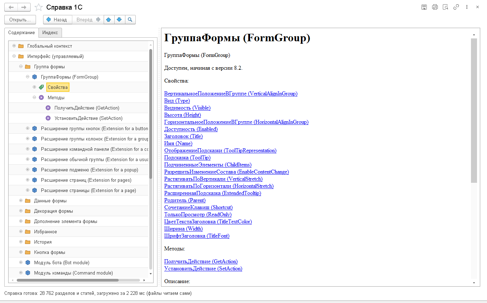

# Синтаксис помощник

Просмотр справки 1С: Синтакс-помощник (.hbk) прямо из режима Предприятия.

:::info
Форк [hbk-viewer](https://github.com/vandalsvq/hbk-viewer). [Лицензия MIT](https://github.com/vandalsvq/hbk-viewer/blob/main/LICENSE)
:::

## Назначение

Внешняя обработка, которая открывает синтакс-помощник платформы прямо из 1С:Предприятия — дерево содержания, предметный указатель и текст статьи в удобном окне, без запуска конфигуратора.

Читает штатные пакеты справки `.hbk` из каталога установки платформы **средствами самой 1С**: ни внешних утилит, ни компонентов, ни распаковки на диск. Формат контейнера разбирается вручную, статья достаётся по смещению одной записи архива.

## Возможности

- **Содержание** — дерево с ленивой подгрузкой: тысячи разделов и статей, разворачивание узла за миллисекунду
- **Индекс** — поиск по началу русского или английского имени, с владельцем через точку: `ТаблицаЗначений.Добавить (ValueTable.Add)`. Удачные запросы копятся в списке выбора
- **Статья** — HTML как есть, со своим оформлением. Ссылки внутри справки открываются в том же окне, внешние — в браузере
- **Навигация** — назад, вперёд, вышестоящий и нижестоящий раздел, «найти в содержании» (раскрывает дерево до открытой статьи)
- **Иконки** видов узлов — раздел, объект, метод, свойство, событие, статья

Пакет открывается примерно за 1,4 секунды, статья показывается за 7 мс, повторно — мгновенно. Память не раздувается: файл читается потоком, статьи достаются по одной.

## Быстрый старт

1. Откройте меню **Универсальные инструменты → Синтаксис помощник**
2. Обработка автоматически найдёт пакет справки в каталоге установки платформы
3. Выберите нужную статью в дереве содержания или воспользуйтесь индексом

## Содержание

Дерево содержания отображает структуру справки с иконками для разных типов узлов:

- Разделы оглавления (категории)
- Объекты метаданных (справочники, документы, регистры)
- Методы, свойства, события объектов
- Отдельные статьи

Узлы с детьми подгружаются лениво — при разворачивании. Это позволяет быстро открыть пакет с десятками тысяч разделов, не загружая всё дерево сразу.

## Индекс

Поиск по предметному указателю работает по началу русского или английского имени:

- Начните вводить название объекта или метода в поле поиска
- Результаты отображаются в алфавитном порядке, как в оригинальном синтакс-помощнике
- Полное имя включает владельцев через точку: `ТаблицаЗначений.Добавить (ValueTable.Add)`
- Удачные запросы сохраняются в списке выбора для быстрого повторного поиска

## Статья

Текст статьи отображается в HTML-поле с полным оформлением оригинальной справки:

- Внутренние ссылки (переходы к другим статьям) открываются в том же окне
- Внешние ссылки (http, mailto) открываются в браузере
- Поддерживаются все элементы форматирования: таблицы, примеры кода, блоки заметок

## Навигация

На панели инструментов доступны кнопки навигации:

| Кнопка | Действие |
|--------|----------|
| **Назад** | Вернуться к предыдущей просмотренной статье |
| **Вперёд** | Перейти к следующей статье (после возврата назад) |
| **Вышестоящий** | Перейти к ближайшей статье уровнем выше |
| **Нижестоящий** | Перейти к первой вложенной статье |
| **Найти в содержании** | Раскрыть дерево содержания до текущей статьи |

## Открытие пакета справки

Обработка автоматически ищет пакет справки в стандартном каталоге установки платформы. Если пакет не найден или нужен другой файл справки:

1. Нажмите кнопку **Открыть** на панели инструментов
2. В диалоге выберите файл `shcntx_*.hbk`
3. Пакет загрузится и дерево содержания заполнится автоматически

## Где читаются файлы

Работа с данными клиент-серверная, и **где читать — решается по доступности файла**:

| Режим | Поведение |
|-------|----------|
| **Тонкий клиент** | Читает пакет сам — файл лежит рядом, это установка платформы |
| **Толстый клиент** | Читает пакет сам — файл доступен локально |
| **Клиент не видит файл** | Переход на сервер: другая машина, другая ОС, сетевой каталог |
| **Веб-клиент** | Файлов не видит вовсе — только через сервер |

## Требования

- Платформа 1С:Предприятие 8.3.14 или новее

## Связанные разделы

- [Консоль запросов](/docs/tools/development-tools/query-console) — разработка запросов с автодополнением из метаданных
- [Консоль кода](/docs/tools/development-tools/code-console) — выполнение произвольного кода 1С
- [Редактор кода в консолях](/docs/tools/development-tools/code-console) — подсветка синтаксиса и автодополнение
